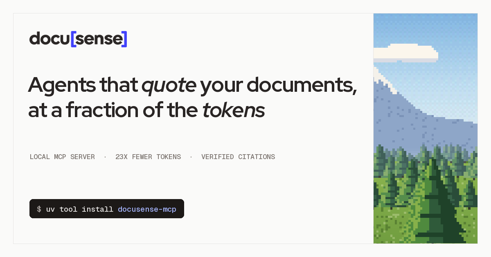

<p align="center">
  
</p>

<p align="center">
  <picture>
    <source media="(prefers-color-scheme: dark)" srcset="https://raw.githubusercontent.com/hksharma2004/docu-sense/main/docs/assets/docusense-wordmark-dark.png">
    
  </picture>
</p>

# DocuSense

**Stop pasting whole documents into your agent.**

DocuSense is a local MCP server that lets Claude, Cursor and other AI agents read your PDFs, Word files
and docs *by section and by claim*, so they load the few hundred tokens that answer the question instead
of the whole 50,000-token file. Every answer comes with a citation to the exact passage.

```
pasting the docs   ████████████████████████████████████████  160,179 tokens
vector RAG         ████                                         15,765 tokens
DocuSense          ██                                            6,869 tokens   → 23x less than pasting
```

<!-- mcp-name: io.github.hksharma2004/docusense -->

## Install

```bash
uv tool install docusense-mcp        # or: pipx install docusense-mcp
docusense setup                      # connects to Claude Code
docusense add ~/docs contract.pdf    # files or whole folders
```

That's it. Ask your agent about your documents.

Other clients: `docusense setup claude-desktop`, `docusense setup cursor`, or `docusense setup print`
for a config snippet to paste anywhere. Claude Desktop users can also install the one-click
`docusense.mcpb` from the [releases page](https://github.com/hksharma2004/docu-sense/releases).

Supported files: PDF, Word (.docx), HTML, Markdown, plain text.

## See what you saved

Example:

```console
$ docusense savings
12 agent sessions · 87 tool calls
read via DocuSense:         41,302 tokens
pasting the docs:          912,440 tokens
saved:                     871,138 tokens (22.1x less context)
```

## Why it uses fewer tokens

| You ask | Pasting the docs | Vector RAG | DocuSense |
|---|---|---|---|
| A precise fact, with a citation | 9,090 tokens | 5,362 tokens of nearby chunks | **478 tokens**: the exact paragraph |
| What changed between two versions | 97,895 tokens | 5,292 tokens, can't diff | **2,776 tokens**: just the changes |
| Does document A conflict with B? | 53,194 tokens | 5,111 tokens, hit or miss | **3,615 tokens**: both conflicting passages |

- **Reads like a person.** Your agent sees the table of contents, opens the right section, and reads
  only the paragraph it needs.
- **Tracks versions.** Add a changed file again and DocuSense keeps both versions. Ask what changed
  without loading either one.
- **Finds contradictions** between documents, with both sides cited.
- **Citations you can trust.** Every passage is fingerprinted, so a made-up quote can't pass as a real one.
- **Private and free.** Runs on your machine. No API key, no account, nothing uploaded.

## Great for

- Long specs, API references and design docs while coding in Claude Code or Cursor
- Checking policies against standards and tracking revisions
- Contracts, handbooks and research papers where you need exact quotes and page numbers
- Any agent that keeps re-reading the same large files

If your documents are a few short files that already fit in context, you don't need DocuSense.

## What your agent can do

| | |
|---|---|
| Browse | list documents, view the table of contents, read a section |
| Find | search, find requirements and rules, look up definitions, follow cross-references |
| Cite | get a verified quote, pack evidence into a token budget |
| Compare | list versions, diff versions, see when a line changed, find contradictions, find affected documents |
| Add | add files on its own and track progress |

Set `DOCUSENSE_TOOLS=core` for a smaller tool set if your agent's context is tight.

## Disk use and old versions

History is append-only: a changed file becomes a new version and old versions stay citable. To keep
disk in check, compact old versions:

```console
$ docusense du                                  # what each version uses on disk
$ docusense compact --keep-last 3 --older-than 90d
```

Compaction deletes an old version's original file and its search embeddings, which are most of its
size. Its text stays, so every citation into it still verifies, and `diff`, `blame` and keyword search
keep working. The latest version of a document is never compacted. Each compaction is recorded with a
Merkle root of the version's passage hashes.

## Settings

| Variable | Default | |
|---|---|---|
| `DOCUSENSE_HOME` | `~/.docusense` | where your data lives |
| `DOCUSENSE_ADD_ROOTS` | your home folder | folders the agent may add files from |
| `DOCUSENSE_TOOLS` | `all` | `core` for fewer tools |
| `DOCUSENSE_SAVINGS_LOG` | `1` | `0` turns off the local savings log |
| `DOCUSENSE_RETAIN` | off | compact old versions after each add, e.g. `keep-last=5,older-than=180d` |

Share one library across several agents: `docusense serve-mcp --http` (set `DOCUSENSE_HTTP_TOKEN`
when exposing it beyond localhost).

The first time you add documents, DocuSense downloads a small local search model (~130 MB) once.

## License

MIT
